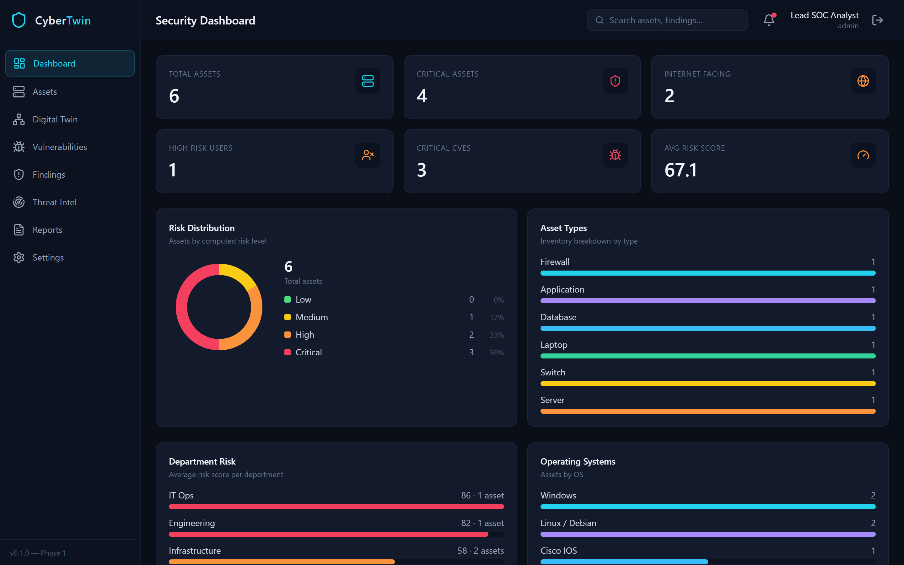
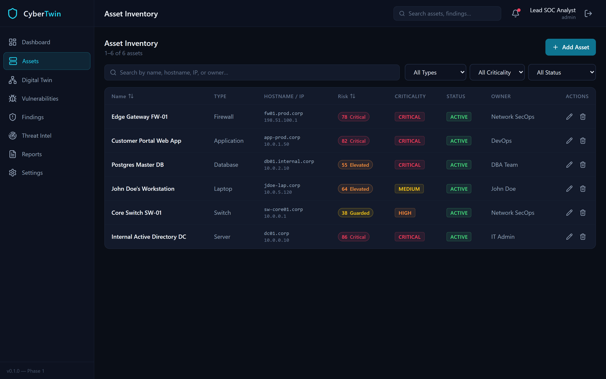
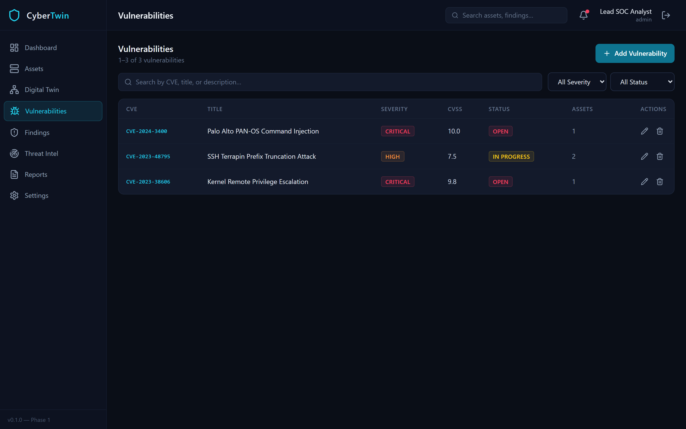
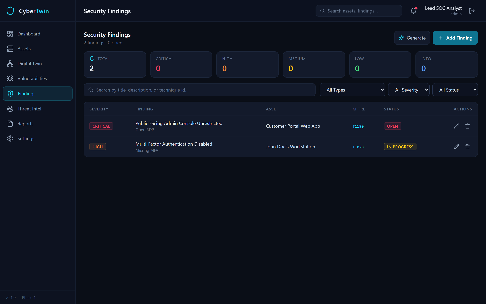
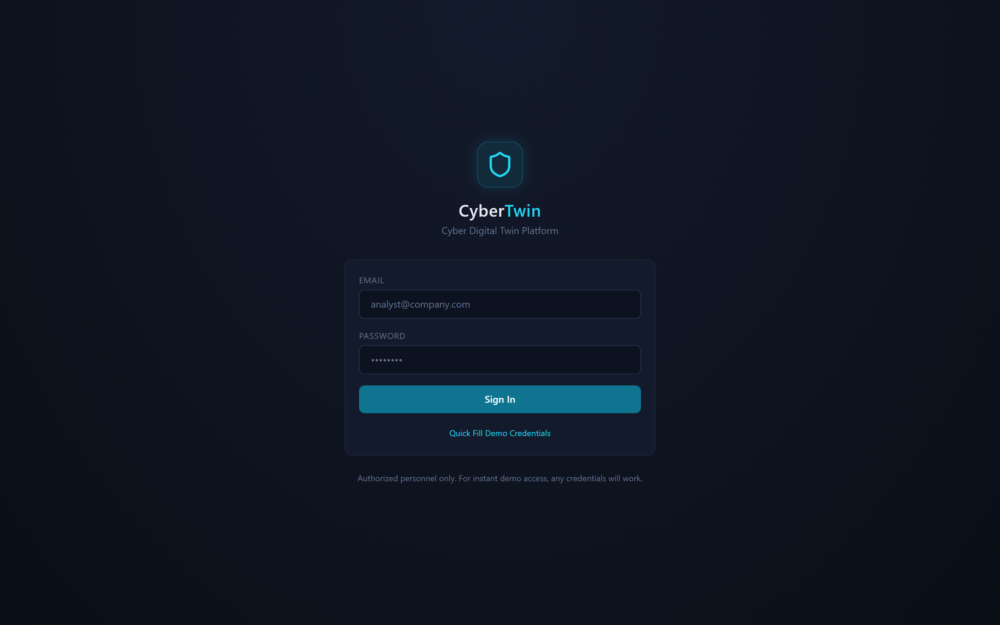

<div align="center">

# 🛡️ CyberTwin
### Enterprise Cyber Digital Twin & Threat Exposure Management Platform

[](https://python.org)
[](https://fastapi.tiangolo.com)
[](https://react.dev)
[](https://www.typescriptlang.org)
[](https://tailwindcss.com)
[](https://neo4j.com)
[](https://postgresql.org)
[](LICENSE)

*An enterprise-grade cyber digital twin designed to map complex attack surfaces, simulate lateral movement vectors, calculate blast radius in real time, and quantify risk using actionable threat intelligence.*

---

</div>

## 📌 Executive Summary

Modern enterprise IT/OT environments suffer from fragmented visibility across on-prem, multi-cloud, and remote endpoints. **CyberTwin** bridges this gap by maintaining a high-fidelity, real-time digital replica of an organization's interconnected cyber assets.

By leveraging **graph theory (Neo4j)** and **Bayesian attack progression models**, CyberTwin calculates risk scores, identifies hidden choke points, simulates exploit paths, and enables proactive attack surface reduction before adversaries can strike.

---

## 📸 Interactive Tour & Screen Demonstrations

| Screenshot | Description |
| :--- | :--- |
|  | **Enterprise SOC Risk Dashboard**<br>Real-time security posture indicators, mean organizational risk score (0–100), critical asset count, exposed internet gateways, risk distribution breakdown, and department-level risk indices. |
|  | **Interactive Cyber Twin Graph Engine**<br>Force-directed interactive network graph visualizing multi-tier relationships (`CONNECTS_TO`, `RUNS_ON`, `STORES`, `PROTECTS`, `MEMBER_OF`) with contextual risk-color halos and criticality tiers. |
|  | **Graph-Based Attack Path & Chokepoint Simulation**<br>Simulates multi-hop lateral movement vectors from perimeter ingress firewalls down to crown-jewel databases and domain controllers. Identifies single-point bottleneck chokepoints. |
|  | **Comprehensive Asset Inventory & Risk Profiler**<br>Detailed registry of all physical, virtual, and cloud assets with live filtering across criticality, risk tiers, departments, open ports, and operating systems. |
|  | **Vulnerability & CVE Posture Engine**<br>Aggregated CVE tracking enriched with CVSS v3/v4 metrics, EPSS (Exploit Prediction Scoring System), affected asset mappings, and vendor remediation bulletins. |
|  | **Remediation Findings & MITRE ATT&CK Mapping**<br>Actionable security tickets categorized by severity, mapped directly to MITRE ATT&CK tactics (Initial Access, Credential Access, Lateral Movement) with SLA tracking. |
|  | **Proactive Threat Intelligence Feeds**<br>Continuous correlation against CISA Known Exploited Vulnerabilities (KEV), threat actor campaigns (e.g., Storm-1575, FIN7), and real-time weaponization feeds. |
|  | **Role-Based Zero-Trust Authentication Portal**<br>JWT-authenticated access control with session isolation and role-based permissions (SecOps Analyst, Incident Responder, Admin). |

---

## ⚡ Core Capabilities

- **🌐 Graph-Driven Digital Twin**: Seamlessly ingests infrastructure states to construct an interactive topological graph powered by Neo4j.
- **🎯 Dynamic Attack Path Traversal**: Calculates breach likelihood across attack chains and highlights critical architectural chokepoints where a single remediation breaks multiple kill chains.
- **📊 Multi-Factor Risk Engine**: Computes dynamic 0–100 risk scores combining CVSS, internet exposure, missing MFA, weak passwords, and business criticality weights.
- **🧠 Threat Intelligence Correlation**: Ingests CISA KEV and MITRE ATT&CK frameworks to prioritize actual in-the-wild threats over theoretical flaws.
- **⚡ Modern Async Microservice Architecture**: FastAPI async I/O backend paired with a high-performance React 18, Vite, and Tailwind CSS client.

---

## 🛠️ Architecture & Stack

```
                          ┌───────────────────────────┐
                          │   React 18 + TypeScript   │
                          │   Vite + Tailwind CSS     │
                          └─────────────┬─────────────┘
                                        │ REST / JWT
                                        ▼
                          ┌───────────────────────────┐
                          │    FastAPI Async Engine   │
                          └──────┬─────────────┬──────┘
                                 │             │
                SQLAlchemy Async │             │ Async Bolt Driver
                                 ▼             ▼
                    ┌──────────────────┐ ┌──────────────────┐
                    │ PostgreSQL 16    │ │ Neo4j Graph DB   │
                    │ Relational Data, │ │ Twin Topology,   │
                    │ CVEs, Assets     │ │ Attack Paths     │
                    └──────────────────┘ └──────────────────┘
```

---

## 🚀 Quick Start Guide

### Prerequisites
- Node.js (v18+)
- Python (3.11+)
- *(Optional)* Docker for hosting PostgreSQL and Neo4j

### 1. Frontend Setup
```bash
cd frontend
npm install
npm run dev
```
Access the application at `http://localhost:5173`.

### 2. Backend Setup
```bash
cd backend
python -m venv .venv
# Windows:
.\.venv\Scripts\activate
# Linux/macOS:
# source .venv/bin/activate

pip install -r requirements.txt
copy .env.example .env
uvicorn app.main:app --reload --port 8000
```
Interactive OpenAPI documentation will be accessible at `http://localhost:8000/docs`.

---

## 👥 Security & Contributing
Contributions are welcomed! Please open an issue or pull request for any bugs or enhancements.

## 📄 License
This project is licensed under the MIT License - see the [LICENSE](LICENSE) file for details.
