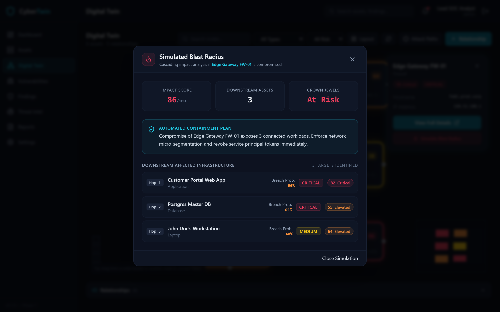
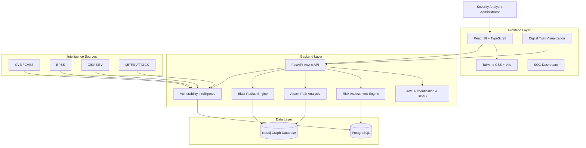

<div align="center">

# 🛡️ CyberTwin
### Enterprise Cyber Digital Twin & Intelligent Threat Exposure Management Platform

*Model your attack surface. Understand your exposure. Predict potential impact. Strengthen your security posture.*

[](https://python.org)
[](https://fastapi.tiangolo.com)
[](https://react.dev)
[](https://www.typescriptlang.org)
[](https://tailwindcss.com)
[](https://neo4j.com)
[](https://postgresql.org)
[](LICENSE)

</div>

CyberTwin is an interactive Cyber Digital Twin and intelligent security operations platform designed to model enterprise IT infrastructure, visualize interconnected attack surfaces, identify potential attack paths, and assess the impact of security compromises.

Combining graph-driven infrastructure modeling, vulnerability intelligence, contextual risk analysis, and SOC monitoring, CyberTwin transforms complex infrastructure relationships into actionable security insights.

It enables security teams to understand how assets connect, where critical exposure exists, how a compromise could propagate, and which remediation actions provide the greatest security impact.

---

## 📌 01. Project Overview

Modern enterprise environments consist of interconnected endpoints, servers, cloud workloads, identities, applications, and network infrastructure. Traditional security monitoring tools often provide fragmented visibility into these relationships.

CyberTwin addresses this challenge through a graph-driven digital representation of enterprise infrastructure.

The platform builds an interactive topology of organizational assets and their relationships, enabling security analysts to:
- **Visualize enterprise infrastructure** through an interactive digital twin.
- **Discover relationships and dependencies** between critical assets.
- **Identify potential attack paths** across interconnected systems.
- **Calculate the potential blast radius** of a compromised asset.
- **Correlate vulnerabilities** with asset exposure and business criticality.
- **Prioritize remediation** based on contextual security risk.
- **Monitor security findings** through a centralized SOC dashboard.
- **Understand potential attack progression** through controlled simulations.

> **Core philosophy:** Move beyond identifying individual vulnerabilities toward understanding how vulnerabilities, asset relationships, and security weaknesses combine to create organizational risk.

---

## 🎯 02. Core Capabilities

### 🌐 Interactive Cyber Digital Twin
A graph-driven virtual representation of enterprise infrastructure.
- Interactive force-directed infrastructure topology.
- Asset relationship visualization.
- Network and infrastructure dependency mapping.
- Risk-based asset highlighting.
- Criticality-based visual classification.
- Multi-tier infrastructure exploration.

Supported relationship models include:

| Relationship | Description |
| :--- | :--- |
| `CONNECTS_TO` | Network connectivity |
| `RUNS_ON` | Application or workload dependency |
| `STORES` | Data storage relationship |
| `PROTECTS` | Security control relationship |
| `MEMBER_OF` | Identity or organizational membership |

### 🎯 Attack Path Analysis
Analyze potential compromise routes across interconnected infrastructure.
- Graph-based attack path discovery.
- Multi-hop relationship traversal.
- Identification of exposed infrastructure.
- Critical asset exposure analysis.
- Attack-path chokepoint identification.
- Remediation impact assessment.

*The objective is to understand how an isolated security weakness could contribute to a larger attack scenario.*

### 💥 Blast Radius Analysis
Evaluate the potential organizational impact of a compromised asset.
- Identify directly connected assets.
- Explore downstream infrastructure dependencies.
- Map privileged identity relationships.
- Identify affected business-critical resources.
- Assess potential compromise propagation.
- Visualize affected infrastructure within the digital twin.

### 🔍 Vulnerability Intelligence Engine
Centralize vulnerability information and connect it with infrastructure exposure.
- CVE identification and tracking.
- CVSS v3/v4 severity intelligence.
- EPSS-based exploitation probability context.
- CISA Known Exploited Vulnerabilities (KEV) correlation.
- Affected asset identification.
- Vulnerability severity classification.
- Remediation status tracking.

### 📊 Contextual Risk Assessment
Move beyond traditional severity-only vulnerability prioritization. CyberTwin combines multiple risk indicators to provide contextual asset-level security assessments.

**Risk factors include:**
- CVSS severity.
- Internet exposure.
- Asset criticality.
- Identity and access weaknesses.
- Missing security controls.
- Attack-path exposure.
- Vulnerability intelligence.

Risk scores are designed to help analysts prioritize security issues based on potential organizational impact.

### 🖥️ Intelligent SOC Dashboard
A centralized security operations interface providing visibility into organizational security posture.
- Organizational risk overview.
- Critical asset monitoring.
- Internet-exposed asset tracking.
- Security findings distribution.
- Department-level risk visualization.
- Vulnerability posture monitoring.
- Investigation and remediation tracking.

### 🧠 Threat Intelligence & MITRE ATT&CK
Integrate threat intelligence with infrastructure exposure and security findings.
- CISA KEV intelligence.
- MITRE ATT&CK technique mapping.
- Threat-related vulnerability prioritization.
- Security finding classification.
- Investigation context and remediation tracking.

### 🔐 Zero Trust Authentication
Secure application access through identity-aware authentication and authorization.
- JWT-based authentication.
- Role-based access control (RBAC).
- SecOps Analyst permissions.
- Incident Responder permissions.
- Administrator permissions.
- Protected application resources.

---

## 📸 03. Interactive Platform Demonstrations

| Screenshot | Module | Description |
| :--- | :--- | :--- |
|  | **SOC Dashboard** | Enterprise security overview with organizational risk indicators, critical asset counts, exposure metrics, and risk distribution. |
|  | **Digital Twin Graph** | Interactive infrastructure topology displaying asset relationships, dependencies, and risk-based visual indicators. |
|  | **Attack Path Analysis** | Graph-based analysis of potential compromise routes and critical infrastructure chokepoints. |
|  | **Blast Radius & Cascading Failure Simulator** | Evaluates cascading compromise propagation, calculates multi-hop breach probabilities, flags crown-jewel exposure, and generates automated containment plans. |
|  | **Asset Inventory** | Centralized asset registry with filtering by criticality, risk, department, operating system, and exposure. |
|  | **Vulnerability Intelligence** | CVE tracking with CVSS, EPSS, KEV correlation, affected assets, and remediation information. |
|  | **Security Findings** | Actionable security findings with severity classification, MITRE ATT&CK mapping, and remediation tracking. |
|  | **Zero Trust Login** | JWT-authenticated access with role-based permissions. |

*Screenshots and visual demonstrations are maintained in `docs/screenshots/`.*

---

## 🏗️ 04. System Architecture

CyberTwin follows a modular architecture separating the frontend presentation layer, backend processing engine, relational data management, and graph-based infrastructure intelligence.



### Architecture Components

| Layer | Technology | Responsibility |
| :--- | :--- | :--- |
| **Frontend** | React 18 | Application interface |
| **Language** | TypeScript | Type-safe frontend development |
| **Build Tool** | Vite | Development and production builds |
| **Styling** | Tailwind CSS | Responsive interface |
| **Backend** | FastAPI | Asynchronous API services |
| **Database ORM** | SQLAlchemy | Relational data access |
| **Relational Database** | PostgreSQL 16 | Assets, users, findings, vulnerability records |
| **Graph Database** | Neo4j | Infrastructure topology and graph relationships |
| **Authentication** | JWT | Session authentication and access control |
| **Threat Intelligence** | CVE, EPSS, CISA KEV, MITRE ATT&CK | Vulnerability and threat context |

---

## ⚙️ 05. Technology Stack

- **Frontend:** React 18, TypeScript, Vite, Tailwind CSS
- **Backend:** Python 3.11+, FastAPI, SQLAlchemy Async, Async API architecture
- **Databases:** PostgreSQL 16, Neo4j Graph Database
- **Security & Intelligence:** JWT Authentication, Role-Based Access Control, CVE / CVSS, EPSS, CISA KEV, MITRE ATT&CK
- **Development & Infrastructure:** Git, GitHub, Docker (optional)

---

## 🚀 06. Getting Started

### Prerequisites
Ensure the following tools are installed:
- Python 3.11 or later
- Node.js 18 or later
- npm
- PostgreSQL 16
- Neo4j
- Git

*(Docker can optionally be used to run the database services).*

### 1. Clone the Repository
```bash
git clone https://github.com/Shafeeq-Cybersec/CyberTwin.git
cd CyberTwin
```

### 2. Configure the Backend
```bash
cd backend
python -m venv .venv

# Windows
.\.venv\Scripts\activate

# Linux / macOS
source .venv/bin/activate
```

Install backend dependencies:
```bash
pip install -r requirements.txt
```

Configure environment variables using the supplied example file:
```bash
copy .env.example .env
```
Configure the required database connections and application settings in `.env`.

Start the backend:
```bash
uvicorn app.main:app --reload --port 8000
```
- **Backend API:** `http://localhost:8000`
- **Interactive API documentation:** `http://localhost:8000/docs`

### 3. Configure the Frontend
Open a new terminal:
```bash
cd frontend
npm install
npm run dev
```
- **Frontend application:** `http://localhost:5173`

### 4. Database Configuration
Ensure PostgreSQL and Neo4j are running and that their connection details match the backend environment configuration. Refer to the backend configuration and database initialization instructions before running the application.

---

## 🛡️ 07. Security Engineering Approach

CyberTwin is designed around several important security engineering principles:

| Principle | Implementation |
| :--- | :--- |
| **Defense in Depth** | Multiple security layers and risk indicators |
| **Zero Trust** | Authenticated access and role-based authorization |
| **Attack Surface Management** | Infrastructure exposure visibility |
| **Graph-Based Security** | Relationship-driven infrastructure analysis |
| **Risk-Based Prioritization** | Contextual vulnerability assessment |
| **Threat-Informed Defense** | MITRE ATT&CK and CISA KEV integration |
| **Proactive Security** | Attack-path and blast-radius analysis |

---

## 🗺️ 08. Development Roadmap

The following roadmap represents planned development milestones. Completion should be updated as features are implemented and tested:

- [x] Initial FastAPI backend architecture
- [x] React and TypeScript frontend foundation
- [x] Initial digital twin visualization
- [x] Initial SOC dashboard interface
- [x] Initial asset inventory interface
- [x] Complete Neo4j infrastructure relationship engine
- [x] Complete graph-based attack path analysis
- [x] Validate blast radius calculations
- [ ] Integrate live vulnerability intelligence feeds
- [x] Implement contextual risk scoring
- [x] Complete security findings and investigation workflows
- [x] Strengthen authentication and authorization
- [ ] Add automated security reporting
- [ ] Add comprehensive automated testing
- [ ] Production deployment and performance validation

---

## 🔬 09. Research & Engineering Focus

CyberTwin explores the intersection of:
- Cyber Digital Twin Technology
- Security Operations Center Engineering
- Attack Surface Management
- Graph-Based Security Analytics
- Vulnerability Intelligence
- Attack Path Analysis
- Identity and Access Security
- Risk-Based Vulnerability Prioritization
- Threat-Informed Defense

The platform aims to demonstrate how infrastructure modeling and graph analytics can improve enterprise security visibility and support proactive security decision-making.

---

## 🔒 10. Responsible Use

CyberTwin is intended for authorized cybersecurity assessment, defensive security research, infrastructure visibility, and security operations.

Attack-path analysis and threat simulations should be performed against authorized environments or controlled synthetic infrastructure.

The platform's calculated risks and simulated attack scenarios are analytical outputs, not guarantees of real-world exploitability or compromise.

---

## 🤝 11. Contributions

Contributions, suggestions, and technical feedback are welcome.

If you identify a bug or have an enhancement proposal:
1. Open a GitHub issue.
2. Describe the problem or proposed improvement.
3. Include relevant technical context.
4. Submit a pull request where appropriate.

---

## 📄 12. License

This project is licensed under the MIT License. See the [LICENSE](LICENSE) file for details.

<div align="center">

Built for Proactive Cyber Defense.  
**CyberTwin** \| Enterprise Cyber Digital Twin & Threat Exposure Management  
Developed by **Shafeeq S**  
[GitHub Repository](https://github.com/Shafeeq-Cybersec/CyberTwin)

</div>

